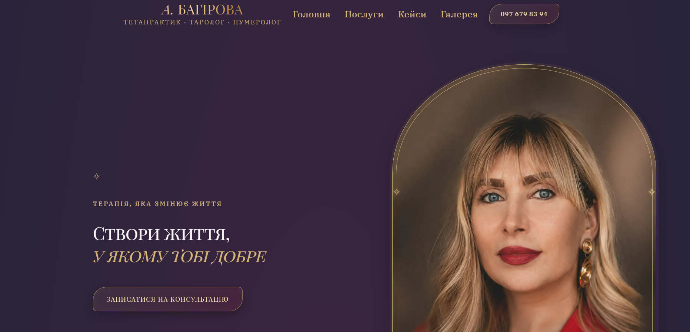

# Назва сайту

Сайт-візитка для [Анна Багірова/тетапрактик/нумеролог/таролог].

🔗 **Демо:** https://nikolaieva7.github.io/teta/

## Функціонал
- Адаптивна верстка для мобільних, планшетів і десктопу
- Галерея робіт
- Відеоблок
- Форма зворотного зв'язку з відправкою в Telegram-бот     
- Сторінка кейсів і політики конфіденційності

## Технології
- HTML5 (семантична верстка)
- CSS3
- JavaScript
- PHP (обробка форми)

## Як запустити локально
1. Клонувати репозиторій:
   `git clone https://github.com/Nikolaieva7/teta.git`
2. Відкрити `index.html` у браузері.

> Форма зворотного зв'язку потребує PHP-хостингу, на GitHub Pages вона не працює.